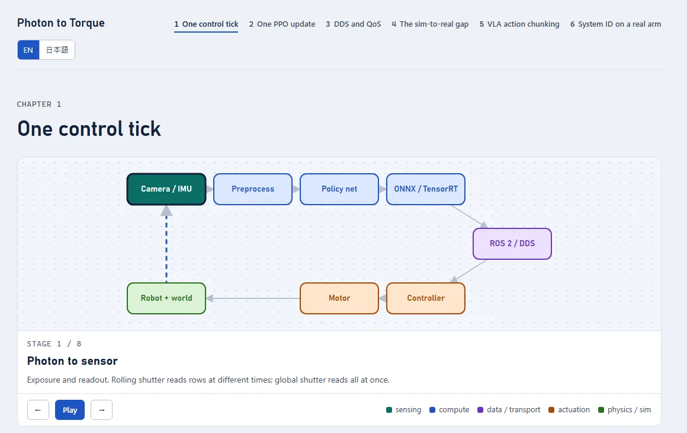

# Photon to Torque

**Open it: https://photon-to-torque.vercel.app**

Follow one robot control tick from the camera to the motor. Each stage shows what happens, how long it may take, how it usually fails, and where every number comes from. A stage nobody measured says "not measured".

## Six chapters

1. **One control tick:** sensor, preprocess, policy, runtime, middleware, controller, actuator, physics.
2. **One PPO update**, step by step.
3. **One ROS 2 message and its QoS**, with a compatibility checker.
4. **The sim-to-real gap:** held-out physics on a simulated arm, and a metric a simulated biped gamed.
5. **VLA action chunking:** chunked against single-step cloning, and whether a chunk covers its own inference time.
6. **System ID on a real arm:** a simulated servo fitted to a public recording of a real SO-100 arm, with a replay of one real episode.

English and Japanese; a test fails if a number differs between the two.

## Sources

Every step lists its own. The ones cited most:

- Measured results: the READMEs of `microduck-rl`, `so-arm100-rl`, `so-arm100-il`, `so-arm100-vla`, `so-arm100-sim`.
- PPO: Schulman et al. 2017 (arXiv:1707.06347); GAE: Schulman et al. 2015 (arXiv:1506.02438); time limits: Pardo et al. 2017 (arXiv:1712.00378); "The 37 Implementation Details of PPO" (ICLR Blog Track 2022).
- Sim-to-real: Tobin et al. 2017 (arXiv:1703.06907); Hwangbo et al. 2019 (arXiv:1901.08652).
- Action chunking: Zhao et al. 2023, ACT (arXiv:2304.13705).
- ROS 2 Jazzy documentation (QoS, executors), ros2_control, OMG DDSI-RTPS.

Built with Vite, React and TypeScript; MIT licence.
